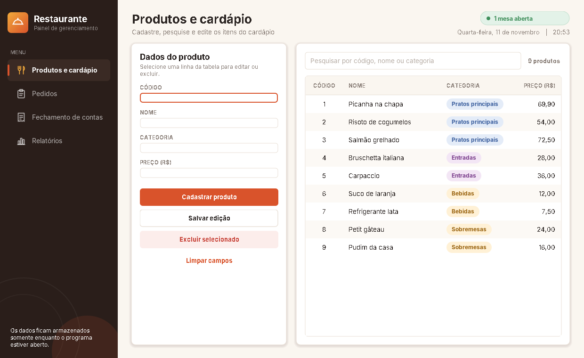
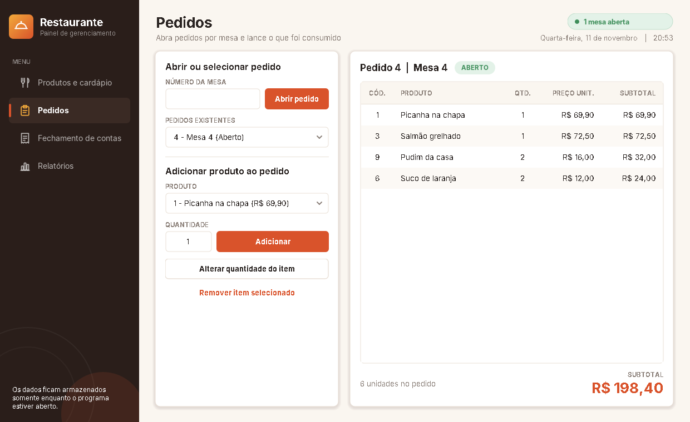
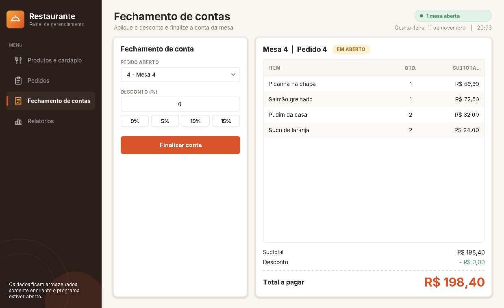
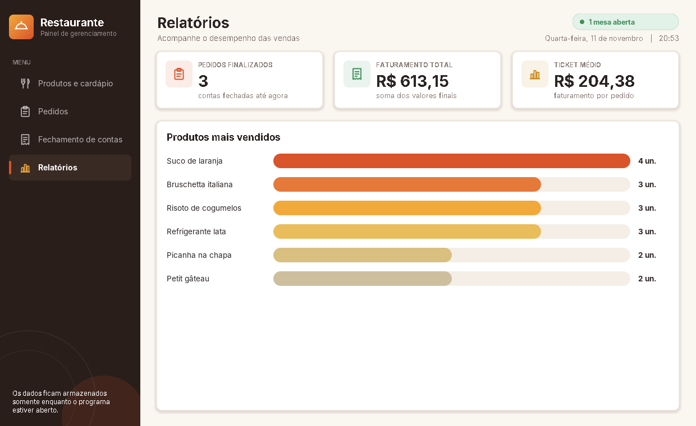
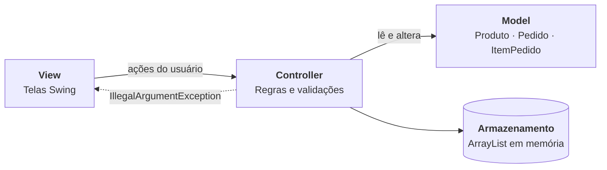
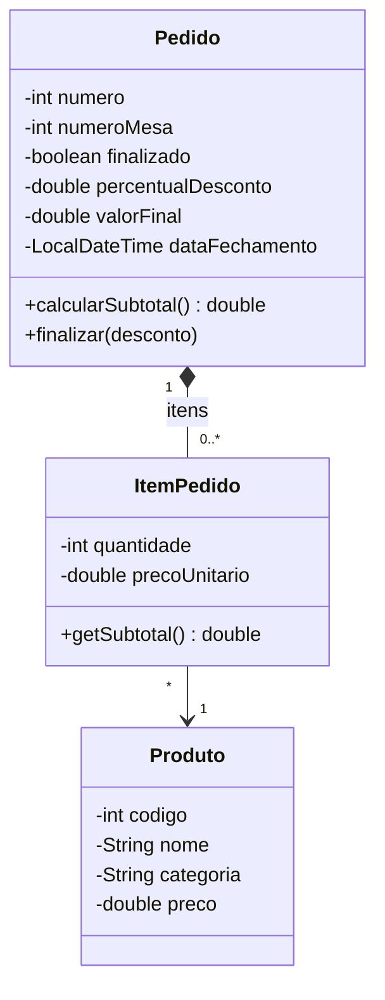

<div align="center">

# 🍽️ Sistema de Gerenciamento de Restaurante

**Aplicação desktop em Java Swing para cardápio, pedidos por mesa, fechamento de contas e relatórios de vendas — com arquitetura MVC e zero dependências externas.**

[](https://github.com/devbrendacosta-oss/Portfolio-Sistema-de-Pedidos-para-Restaurante/actions/workflows/ci.yml)


[Funcionalidades](#-funcionalidades) •
[Capturas de tela](#-capturas-de-tela) •
[Como executar](#-como-executar) •
[Arquitetura](#-arquitetura) •
[Regras de negócio](#-regras-de-negócio) •
[Testes](#-testes)

</div>

---

## 📌 Sobre o projeto

Sistema para o dia a dia de um restaurante: o gerente mantém o **cardápio**, o salão abre **pedidos por mesa**, o caixa **fecha a conta com desconto** e a gestão acompanha o **desempenho das vendas**.

Foi construído **somente com a biblioteca padrão do Java**. A interface inteira (cores, botões, ícones, gráficos de barras e notificações) é desenhada com **Swing + Java2D**, sem imagens, sem frameworks e sem banco de dados.

> **Projeto acadêmico de portfólio.** Os dados ficam em memória (`ArrayList`) e são descartados ao fechar o programa — decisão intencional que atende ao enunciado da atividade e mantém o foco em orientação a objetos, MVC e regras de negócio.

## ✨ Funcionalidades

| Módulo | O que faz |
|---|---|
| 🍴 **Produtos e cardápio** | Cadastrar, listar, pesquisar (por código, nome ou categoria), editar e excluir produtos. Categorias exibidas como etiquetas coloridas. |
| 📋 **Pedidos** | Abrir pedido por número de mesa, adicionar produtos, alterar quantidade e remover itens. Subtotal atualizado em tempo real. |
| 🧾 **Fechamento de contas** | Conferir a conta, aplicar desconto percentual (atalhos 0%, 5%, 10%, 15% ou valor livre) e finalizar. |
| 📊 **Relatórios** | Pedidos finalizados, faturamento total, ticket médio e ranking dos produtos mais vendidos. |

**Extras de experiência de uso**

- Menu lateral com indicador de mesas abertas, data e hora no cabeçalho.
- Atalhos de teclado: <kbd>Ctrl</kbd>+<kbd>1</kbd> a <kbd>Ctrl</kbd>+<kbd>4</kbd> trocam de tela.
- Notificações (*toast*) para confirmar ações e mostrar erros de validação.
- Tema centralizado em uma única classe (`Tema`), fácil de reestilizar.

## 🖼️ Capturas de tela

<table>
  <tr>
    <td align="center" width="50%">
      <br>
      <sub><b>Produtos e cardápio</b></sub>
    </td>
    <td align="center" width="50%">
      <br>
      <sub><b>Pedidos por mesa</b></sub>
    </td>
  </tr>
  <tr>
    <td align="center">
      <br>
      <sub><b>Fechamento de contas</b></sub>
    </td>
    <td align="center">
      <br>
      <sub><b>Relatórios de vendas</b></sub>
    </td>
  </tr>
</table>

## 🛠️ Tecnologias

| Item | Detalhe |
|---|---|
| Linguagem | Java 8 ou superior |
| Interface | Swing e Java2D (biblioteca padrão) |
| Armazenamento | `ArrayList` em memória |
| Build | Maven (opcional) ou `javac` direto |
| CI | GitHub Actions (Java 8, 17 e 21) |
| Banco de dados / frameworks / bibliotecas externas | **Não utiliza** |

## 🚀 Como executar

### Pré-requisitos

- **JDK 8 ou superior** (`java -version` e `javac -version` para conferir)
- Opcional: Maven 3.x ou uma IDE (IntelliJ IDEA, Eclipse, NetBeans)

### Opção 1 — Linha de comando (sem Maven)

```bash
git clone https://github.com/devbrendacosta-oss/Portfolio-Sistema-de-Pedidos-para-Restaurante.git
cd Portfolio-Sistema-de-Pedidos-para-Restaurante

# Linux / macOS
mkdir -p out && javac -encoding UTF-8 -d out $(find src/main -name '*.java')
java -cp out br.com.restaurante.Main
```

```powershell
# Windows (PowerShell)
mkdir out -Force
javac -encoding UTF-8 -d out (Get-ChildItem -Recurse src/main -Filter *.java).FullName
java -cp out br.com.restaurante.Main
```

### Opção 2 — Maven

```bash
mvn compile
java -cp target/classes br.com.restaurante.Main
```

### Opção 3 — IntelliJ IDEA

1. **File ▸ Open** e selecione a pasta do projeto (o `pom.xml` é reconhecido automaticamente).
2. Abra `src/main/java/br/com/restaurante/Main.java`.
3. Clique no triângulo verde ao lado do `main` e escolha **Run 'Main.main()'**.

> Se a IDE não reconhecer as pastas: botão direito em `src/main/java` ▸ **Mark Directory as ▸ Sources Root** e confira se há um JDK 8+ configurado.

## 🏗️ Arquitetura

O projeto segue o padrão **MVC**, com uma camada simples de dados em memória:



As telas **nunca** aplicam regra de negócio: chamam um controller e, se ele lançar `IllegalArgumentException`, mostram a mensagem ao usuário em um *toast*.

### Modelo de classes



### Estrutura de pastas

```
.
├── src/
│   ├── main/java/br/com/restaurante/
│   │   ├── Main.java                  # Ponto de entrada
│   │   ├── model/                     # Produto, Pedido, ItemPedido
│   │   ├── controller/                # ProdutoController, PedidoController,
│   │   │                              # ContaController, RelatorioController
│   │   ├── dados/Armazenamento.java   # Listas em memória
│   │   └── view/                      # Telas (JanelaPrincipal, ProdutosPanel,
│   │                                  # PedidosPanel, FechamentoPanel,
│   │                                  # RelatoriosPanel) e componentes visuais
│   │                                  # (Tema, BotaoModerno, CartaoPanel, Toast, Icones…)
│   └── test/java/br/com/restaurante/
│       └── RegrasDeNegocioTest.java   # 16 testes sem dependências
├── docs/screenshots/                  # Imagens usadas neste README
├── .github/workflows/ci.yml           # Compila e testa a cada push
├── pom.xml
├── LICENSE
└── README.md
```

## 📐 Regras de negócio

| # | Regra | Onde é aplicada |
|---|---|---|
| RF01 | Código do produto deve ser maior que zero e único; nome e categoria são obrigatórios; preço não pode ser negativo | `ProdutoController` |
| RF02 | Pesquisa por código, nome ou categoria, sem diferenciar maiúsculas de minúsculas | `ProdutoController` |
| RF03 | O número da mesa deve ser válido e só pode haver **um pedido aberto por mesa** | `PedidoController` |
| RF04 | Quantidade deve ser maior que zero; adicionar o mesmo produto de novo **soma** a quantidade | `PedidoController` |
| RF05 | Desconto entre **0% e 100%**, aplicado sobre o subtotal; pedido vazio não pode ser fechado | `ContaController` |
| RF06 | Pedido finalizado **não pode ser alterado** nem fechado de novo | `PedidoController`, `ContaController` |
| RF07 | O preço é **copiado para o item** ao adicioná-lo: alterar o cardápio depois não muda pedidos já lançados | `ItemPedido` |
| RF08 | Relatórios consideram **somente pedidos finalizados** | `RelatorioController` |

## 🧪 Testes

Os testes cobrem as regras acima e rodam **sem JUnit ou qualquer biblioteca**:

```bash
mkdir -p out
javac -encoding UTF-8 -d out $(find src -name '*.java')
java -Dfile.encoding=UTF-8 -cp out br.com.restaurante.RegrasDeNegocioTest
```

Saída esperada:

```
  OK     RF01 cadastra produto válido
  OK     RF01 rejeita código duplicado
  ...
16 testes, 16 passaram, 0 falharam.
```

O comando termina com código de saída `1` se algum teste falhar, e o workflow de CI o executa em Java 8, 17 e 21.

## 💡 Exemplo de fluxo

1. Em **Produtos e cardápio**, cadastre alguns itens (ex.: *Picanha na chapa*, categoria *Pratos principais*, R$ 69,90).
2. Em **Pedidos**, informe a mesa `4`, clique em **Abrir pedido** e adicione os produtos.
3. Em **Fechamento de contas**, escolha o pedido, aplique `10%` e clique em **Finalizar conta**.
4. Em **Relatórios**, veja o faturamento, o ticket médio e o ranking atualizados.

## 🔭 Melhorias futuras

- [ ] Persistência em arquivo (JSON/CSV) ou banco de dados (SQLite/PostgreSQL) com padrão DAO
- [ ] Gerar `.jar` executável via Maven
- [ ] Formas de pagamento e divisão de conta
- [ ] Controle de estoque
- [ ] Testes de interface automatizados

## 📈 Status

✅ **Concluído** — versão funcional completa para estudo e demonstração.

## 📄 Licença

Distribuído sob a licença **MIT**. Veja o arquivo [LICENSE](LICENSE).

## 👩‍💻 Autoria

Desenvolvido por **[@devbrendacosta-oss](https://github.com/devbrendacosta-oss)**.

<div align="center">

⭐ Se este projeto foi útil para você, considere deixar uma estrela!

</div>
